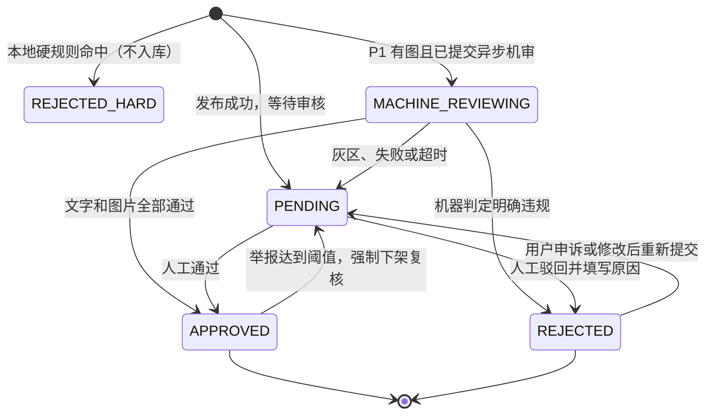
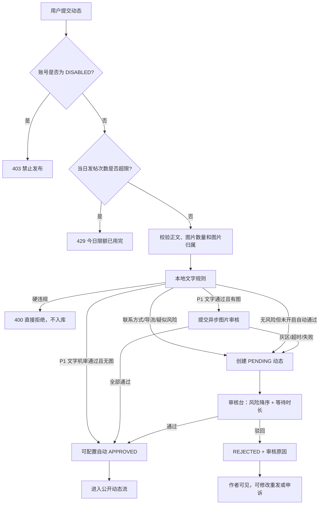
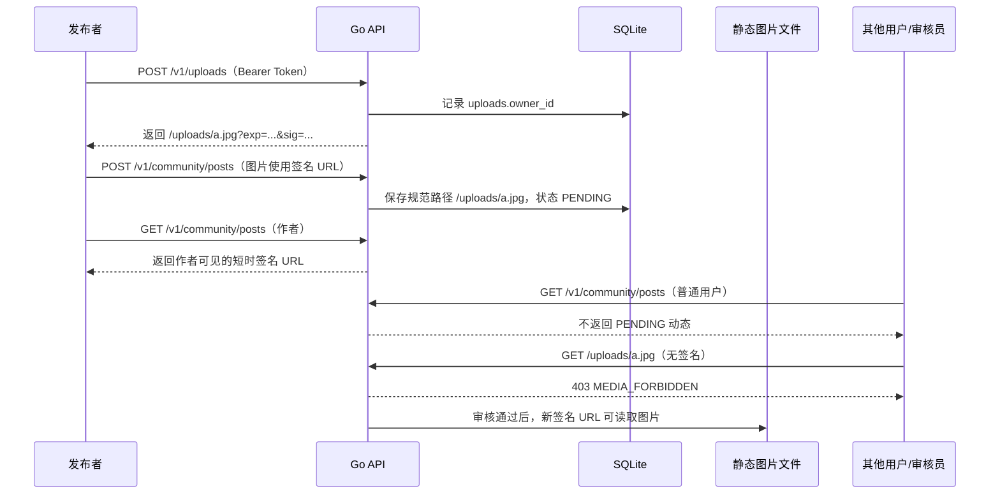

# 社区 UGC 审核需求与设计

本文是社区动态（发帖、图片、评论等 UGC）的产品与技术要求，当前落地范围为 **P0 安全与风控**。机器审核接入方案放在 P1，举报、申诉和处罚闭环放在 P2。

## 1. 背景与目标

社区允许晒宠、打卡、求助和邻里交流。审核目标不是追求零误伤，而是：

1. 违法违规内容不进入公开流量。
2. 正常内容尽快可见，避免所有动态长期卡在人工审核。
3. 审核员能按风险和等待时长处理队列，操作可追溯。
4. 未审核的图片不能通过猜测或转发 URL 被匿名读取。

非目标：

- P0 不接入第三方机器审核，不自动放行图片。
- P0 不实现完整举报、申诉、禁言和违规计分体系。
- P0 不建设独立对象存储，先通过签名 URL 收紧本地 `/uploads` 的访问。

## 2. 角色与产品边界

| 角色 | 能力 |
|---|---|
| 发布者 | 上传图片、发布动态、查看自己的审核中/驳回动态和原因 |
| 普通用户 | 仅查看 `APPROVED` 动态；看不到他人的待审内容 |
| 审核员 | 查看待审队列、图片、本地风险标签，通过或驳回 |
| 平台 | 执行频控、账号状态校验、图片归属校验和审计记录 |

可见性规则：

- `APPROVED` 进入公开动态流。
- `PENDING`、`REJECTED` 仅作者本人和审核后台可见。
- 硬违规内容直接返回业务错误，不写入公开动态。
- 作者可见自己的驳回原因；其他用户永远看不到审核字段。

## 3. 风险分级与处置

| 级别 | 典型内容 | 机器动作 | 人工动作 |
|---|---|---|---|
| `HIGH` | 色情、赌博、毒品、枪爆、虐宠、诈骗、身份证等高风险信息 | 直接拒绝，或进入最高优先级人工队列 | 抽检并决定账号处罚 |
| `MEDIUM` | 手机号、微信/QQ、外链、二维码文案、疑似广告、普通图文 | 进入人工队列 | 必审 |
| `LOW` | 干净文字，且图片已通过可信图片审核 | 可自动通过 | 事后抽检 1%–5% |
| `UNKNOWN` | 机器审核超时、服务降级、结果不确定 | 不得自动通过 | 保持待审，人工兜底 |

P0 当前保持保守策略：本地规则通过后仍默认进入 `PENDING`，只有人工通过才公开。

### 发布决策矩阵

| 本地规则 | 机器文字 | 机器图片 | 结果 |
|---|---|---|---|
| 命中硬违规 | — | — | `400`，不入库 |
| 通过 | `risky` | — | 拒绝或 `REJECTED` |
| 通过 | `pass` | 无图 | P1 可配置自动 `APPROVED` |
| 通过 | `pass` | 异步审核中 | `MACHINE_REVIEWING`，不公开 |
| 通过 | `pass` | `pass` | P1 可自动 `APPROVED` |
| 通过 | `pass` | `review` / 超时 | `PENDING` 人工审核 |
| 命中联系方式/导流 | 任意 | 任意 | `PENDING`，优先人工审核 |

## 4. 状态机

当前代码已实现 `PENDING → APPROVED / REJECTED`；`MACHINE_REVIEWING` 和 `REJECTED_HARD` 是为 P1 预留的产品状态。P0 的硬违规在接口层直接返回 `400`，不产生帖子记录。

## 5. 发布与审核流程

### 审核队列规则

- 默认展示 `PENDING`。
- 排序优先级：`HIGH → MEDIUM → LOW → UNKNOWN`。
- 同风险级别按创建时间升序，先处理等待更久的动态。
- 审核台必须同时展示正文、图片、本地命中原因和发布时间。
- 驳回必须填写可执行、可理解的原因，最多 200 字。
- 通过和驳回都写入审计日志；P2 接入真实审核员账号和 RBAC。

### 服务目标

| 内容类型 | 目标 |
|---|---|
| 干净纯文字 | P1 接入文字机审后，数秒内可见 |
| 含图动态 | 机审通过后数分钟内可见 |
| 人工审核 | 工作时段 2 小时内处理 |
| 硬违规 | 发布接口直接阻断，不公开 |

## 6. 媒体访问安全

### 问题

原始实现使用 `http.FileServer` 暴露 `GET /uploads/*`，任何人拿到或猜到文件名即可读取未审核图片。即使动态还没有出现在信息流中，图片仍可能被转发和传播。

### P0 方案

- `/uploads/{filename}` 必须携带短期签名参数：`?exp=<unix>&sig=<hmac>`。
- 签名内容包含上传路径和过期时间，使用 `HMAC-SHA256`。
- API 返回头像、宠物图、动态图、任务凭证等上传路径时，统一生成短时签名 URL。
- 数据表仍保存规范路径 `/uploads/{filename}`，不保存签名参数。
- 客户端提交已签名 URL 时，服务端会先还原为规范路径再入库。
- 签名默认有效期为 1 小时；过期后需要重新请求 API 获取新 URL。
- `UPLOAD_SIGNING_KEY` 在生产环境必须设置为至少 16 字节的高强度随机密钥；缺省或过短时会生成进程级临时密钥，服务重启后旧 URL 失效。
- 签名 URL 是短期不记名凭证，拿到 URL 的人在有效期内可以访问；前端和审核台不得转发完整 URL，日志和审计记录也不保存签名参数。

### 生产演进

P1/P2 建议把本地私有盘替换为私有 OSS/COS，并通过后端签发短时下载 URL。无论存储在哪，都必须满足：

- 未审核媒体不提供长期公开 URL。
- 审核后台使用受控短时 URL，不在日志和审计中记录完整签名。
- 微信图片机审使用的公网 URL 必须短时有效，审核完成后不继续暴露。

## 7. 防滥用规则

P0 已实现：

| 规则 | 阈值 | 行为 |
|---|---|---|
| 新用户每日发帖 | 3 条/日 | 第 4 条返回 `429 RATE_LIMITED` |
| 普通用户每日发帖 | 10 条/日 | 第 11 条返回 `429 RATE_LIMITED` |
| 每日图片上传 | 30 张/日 | 第 31 张返回 `429 RATE_LIMITED` |
| 停用账号 | `DISABLED` | 禁止发布和上传 |
| 图片归属 | 仅本人上传 | 复用他人图片返回 `400` |
| 单帖图片数 | 最多 9 张 | 超限返回 `400` |

“新用户”暂定为账号创建后 7 天内。日界线按 Asia/Shanghai（UTC+8）计算。

P1/P2 继续补充：

- 正文归一化 hash 与图片 perceptual hash，短时重复内容直接拒绝或提高审核优先级。
- 同设备、同 IP、同支付账号的关联风控。
- `N` 人举报后强制下架已通过内容并重新审核。
- 违规计分、临时禁言、封号和一次申诉。

## 8. P1 机器审核设计

### 文字审核

- 首选微信小程序 `security.msgSecCheck`，需要 `access_token`、`scene` 和用户 `openid`。
- 本地词库继续作为前置硬拦截，不替代微信/云厂商审核。
- 同步接口超时或降级时返回 `UNKNOWN`，动态保持 `PENDING`，禁止自动放行。

### 图片审核

- 首选微信 `security.mediaCheckAsync`。
- 提交审核时生成短时签名图片 URL，供微信服务端拉取。
- 保存 `trace_id`、提交时间和过期时间，回调按 `trace_id` 幂等更新。
- 回调验签失败直接拒绝，并记录安全日志。
- 超过约定时间未回调，状态转为 `PENDING`，由人工处理；超时不等于通过。

### 结果合并

- 本地硬违规：直接拒绝，不落公开内容。
- 文字 risky：拒绝或进入高优先级人工队列。
- 文字 pass + 无图 + 自动通过开关开启：`APPROVED`。
- 文字 pass + 图片 pass：`APPROVED`。
- 任一结果未知、失败或灰区：`PENDING`。
- 机器服务整体不可用：所有新内容进入 `PENDING`，关闭自动放行。

## 9. 配置与接口

| 环境变量 | 默认值 | 说明 |
|---|---|---|
| `UPLOAD_SIGNING_KEY` | 空 | 媒体 URL 签名密钥；生产必须设置高强度随机值 |
| `UGC_AUTO_APPROVE_TEXT` | `false` | P0 必须保持关闭；P1 文字机审稳定后再开启 |
| `UGC_REQUIRE_IMAGE_REVIEW` | `true` | P0 图片必须人工复核；P1 图片机审稳定后再调整 |
| `UGC_BLOCKED_TERMS` | 空 | 追加本地硬拦截词，英文逗号分隔 |

现有接口：

- `POST /v1/uploads`：上传图片，返回签名 URL。
- `POST /v1/community/posts`：发布动态，执行账号、频控、图片归属和本地审核。
- `GET /v1/community/posts`：公开流 + 作者自己的审核中/驳回动态。
- `GET /v1/admin/community/posts?status=PENDING`：按风险与等待时长返回审核队列。
- `POST /v1/admin/community/posts/{id}/approve`：人工通过。
- `POST /v1/admin/community/posts/{id}/reject`：人工驳回，必须填写原因。

## 10. 分阶段计划

| 阶段 | 范围 | 验收重点 |
|---|---|---|
| P0（本次） | 媒体签名、频控、停用禁发、风险队列 | 未审图片匿名不可读；限额生效；审核队列有序 |
| P1 | 微信文字/图片机审、异步回调、状态扩展 | 双通过自动放行；超时/降级不误放 |
| P2 | 举报、申诉、违规计分、禁言/封号 | 处置闭环、SLA 看板、抽检与审计 |

## 11. 验收标准

P0 验收：

1. 未签名或过期图片 URL 返回 `403 MEDIA_FORBIDDEN`。
2. 作者和审核员能通过短时签名 URL 查看待审图片。
3. 普通用户看不到待审动态，也拿不到其图片 URL。
4. 动态通过后，普通用户重新请求动态流可获得可读签名 URL。
5. 新用户第 4 条、普通用户第 11 条动态被拒绝；第 31 张图片上传被拒绝。
6. `DISABLED` 账号无法发布动态或上传图片。
7. 后台待审队列先展示 `HIGH`，同风险按等待时间升序。
8. `go test ./...`、`go vet ./...` 和小程序静态校验通过。

## 12. 关键代码位置

- `internal/moderation/moderation.go`：本地文字硬规则和风险分级。
- `internal/httpapi/media.go`：媒体签名、签名校验和响应中的 URL 替换。
- `internal/store/ugc_limits.go`：发帖/上传限额、账号状态和日界线。
- `internal/store/community.go`：发布、公开流、审核队列与审核动作。
- `internal/store/media.go`：客户端签名 URL 还原为规范存储路径。
- `admin/app.js`：审核台动态队列和图片展示。
- `miniprogram/pages/community/`：发布器、审核状态和驳回原因展示。
